<p align="center">
  
</p>

<p align="center">
  <a href="https://entrenamientos.ies.com.uy"></a>
  
  
  
  
</p>

<p align="center">
  
  
  
  
  
  
</p>

# IES Training · academia técnica de IES

**IES Training** es la academia de formación técnica de **IES – Ingeniería en Seguridad** (Uruguay). Forma técnicos de redes, telefonía IP, seguridad electrónica y servidores con cursos cortos y prácticos. Cada lección tiene:

- una **idea en tres líneas**;
- la **teoría** (historia y cómo funciona) con **animaciones**;
- un **laboratorio** con los comandos exactos;
- un **examen** con casos de obra;
- donde hay terminal, un **script listo para pegar**.

Este repositorio tiene todo lo que hace funcionar la academia:

- **El portal:** front sin frameworks y API PHP con SQLite.
- **Los 16 cursos:** investigación, guion, tarjetas y exámenes.
- **El enriquecimiento:** más de 770 ilustraciones y más de 280 animaciones de teoría.
- **Las herramientas** que construyen, enriquecen y publican cada curso.
- **Los scripts de despliegue** en Proxmox detrás de Nginx Proxy Manager.

> **En línea:** <https://entrenamientos.ies.com.uy>. Sin cuenta se ven los títulos y el recorrido; registrándose (gratis) se ve todo y se rinden los exámenes.

---

## Índice

1. [Recorrido en imágenes](#recorrido-en-imágenes)
2. [Los cursos](#los-cursos)
3. [Anatomía de una lección](#anatomía-de-una-lección)
4. [Teoría animada](#teoría-animada)
5. [Ilustraciones de paso](#ilustraciones-de-paso)
6. [Editor y administración](#editor-y-administración)
7. [Arquitectura](#arquitectura)
8. [Cómo se construye un curso](#cómo-se-construye-un-curso)
9. [Cómo se publica](#cómo-se-publica)
10. [Estructura del repositorio](#estructura-del-repositorio)
11. [Herramientas](#herramientas)
12. [Probarlo en tu máquina](#probarlo-en-tu-máquina)
13. [Criterios de contenido](#criterios-de-contenido)
14. [Créditos](#créditos)

---

## Recorrido en imágenes

<table>
  <tr>
    <td width="50%">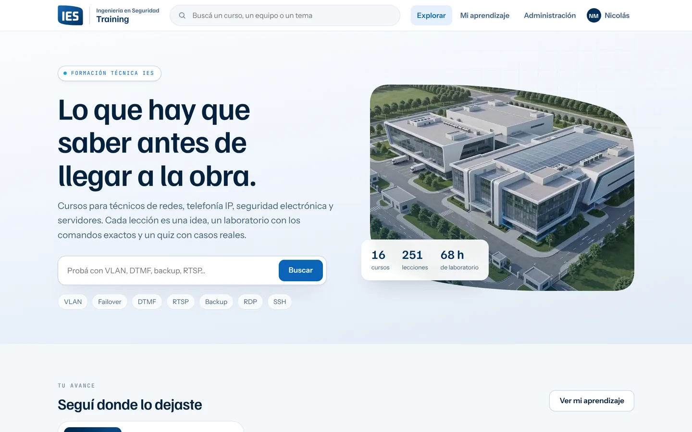<br><sub><b>Portada.</b> Buscador por tema, equipo o protocolo, y lo que te falta para seguir.</sub></td>
    <td width="50%">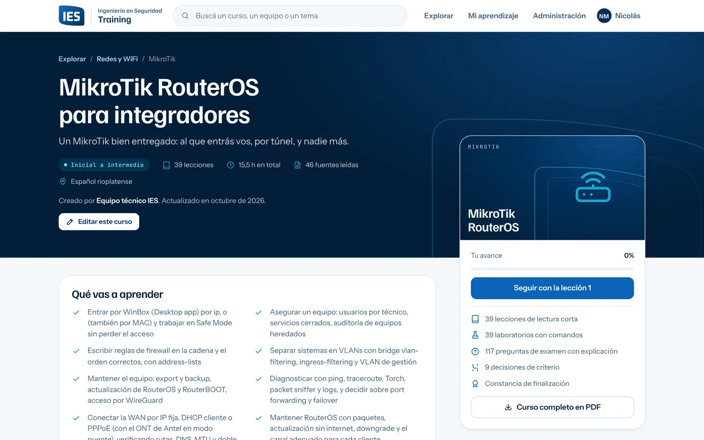<br><sub><b>Curso.</b> Objetivo, recorrido y módulos en orden: cada lección se abre al completar la anterior.</sub></td>
  </tr>
  <tr>
    <td>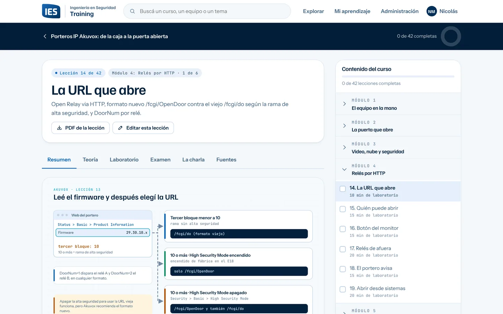<br><sub><b>Lección.</b> Ilustración principal, ideas, de dónde venimos y qué sigue.</sub></td>
    <td>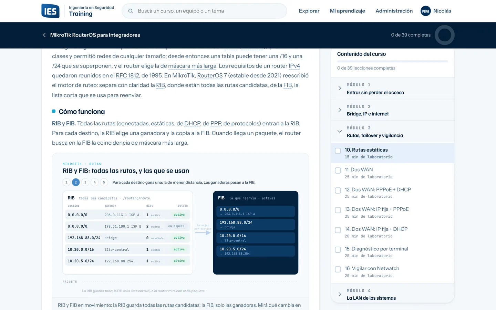<br><sub><b>Teoría animada.</b> La animación va después del párrafo que explica (acá, RIB y FIB en MikroTik).</sub></td>
  </tr>
  <tr>
    <td>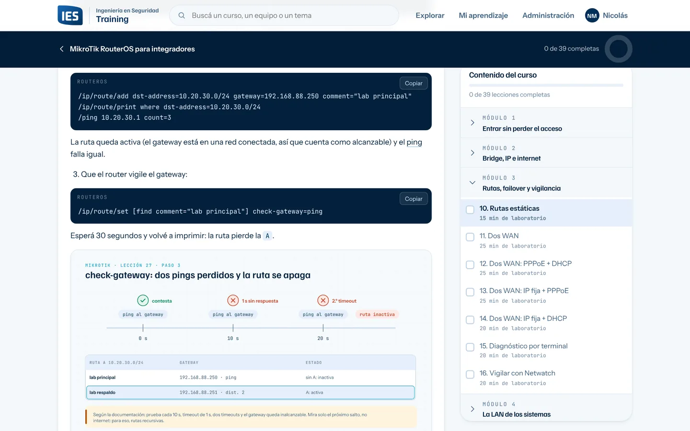<br><sub><b>Laboratorio.</b> Pasos numerados con comandos exactos y la figura justo después del paso que ilustra.</sub></td>
    <td>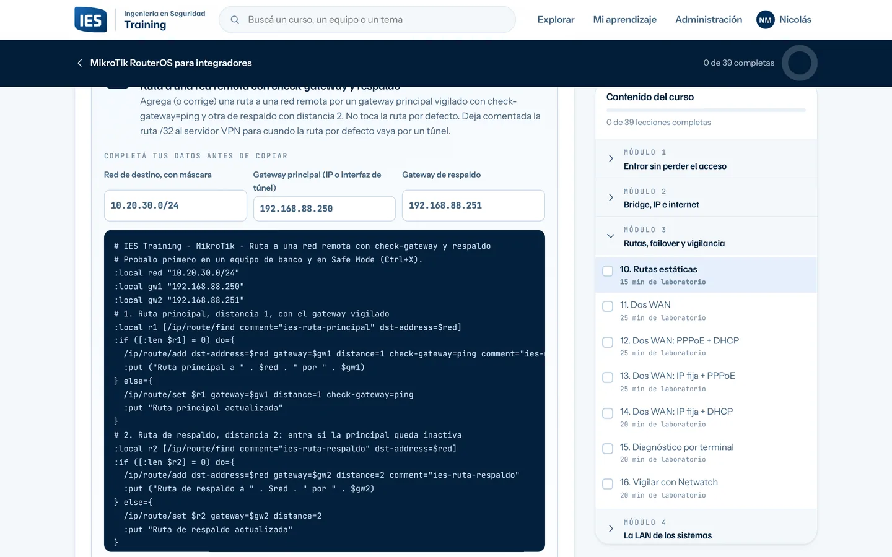<br><sub><b>Script para automatizar.</b> Completás tus datos, se reemplazan en el código y lo copiás o descargás (<code>.rsc</code>, <code>.sh</code> o <code>.ps1</code>).</sub></td>
  </tr>
  <tr>
    <td>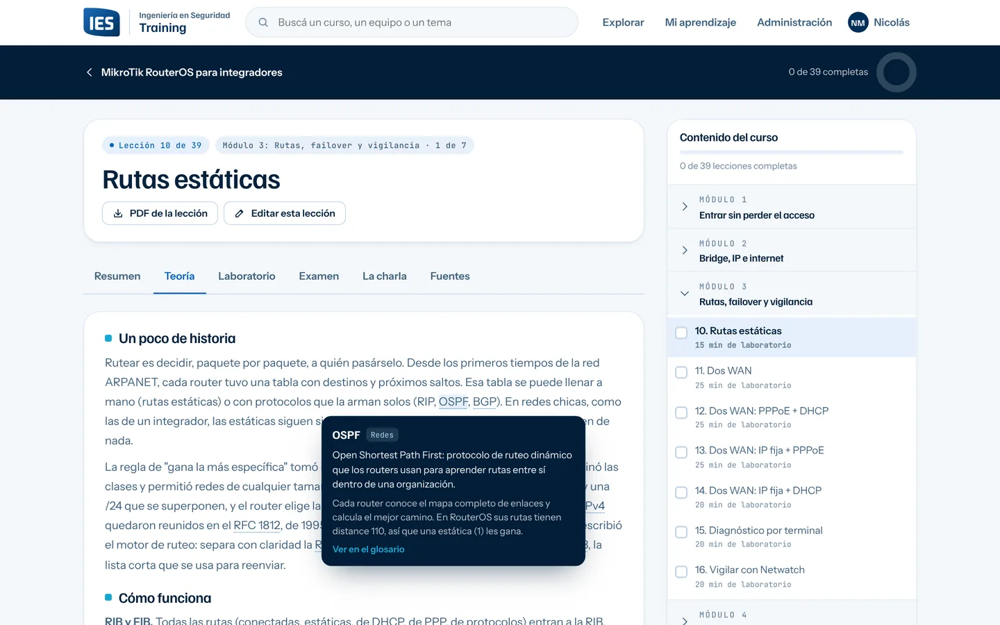<br><sub><b>Glosario en contexto.</b> Cada término técnico y cada RFC explica qué es y para qué se creó, sin salir de la lección.</sub></td>
    <td>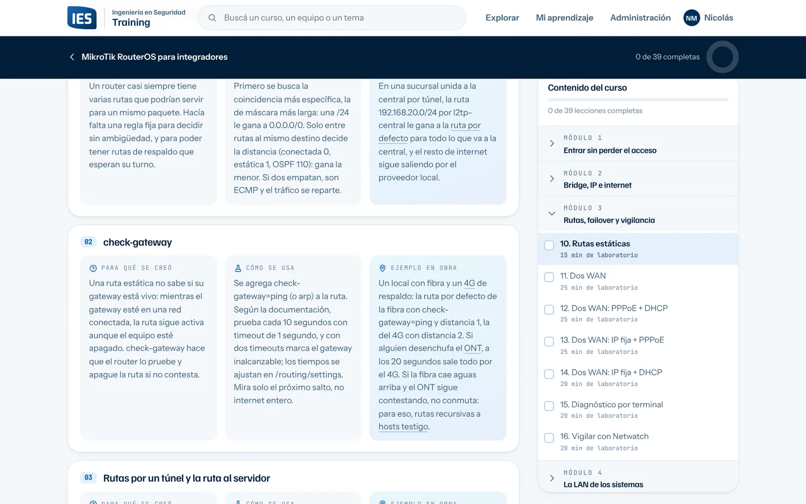<br><sub><b>Conceptos.</b> Para qué se creó, cómo se usa y un ejemplo de obra.</sub></td>
  </tr>
  <tr>
    <td>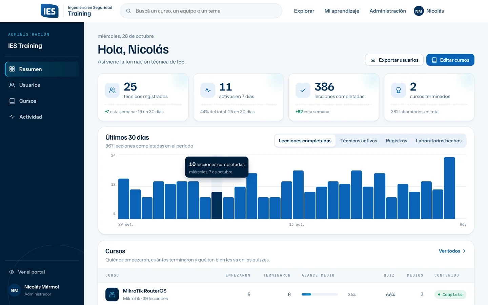<br><sub><b>Administración.</b> Técnicos activos, lecciones completadas, cursos, preguntas que más se fallan y actividad.</sub></td>
    <td>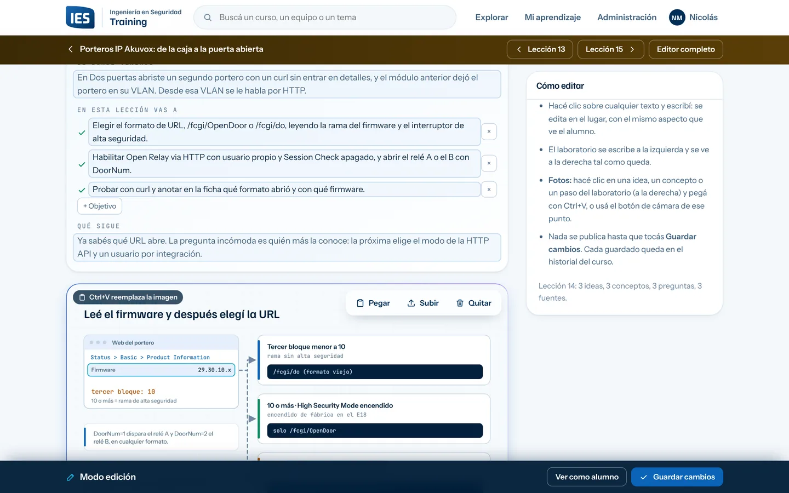<br><sub><b>Edición en el lugar.</b> Se pega una captura con Ctrl+V y se guarda sola.</sub></td>
  </tr>
  <tr>
    <td>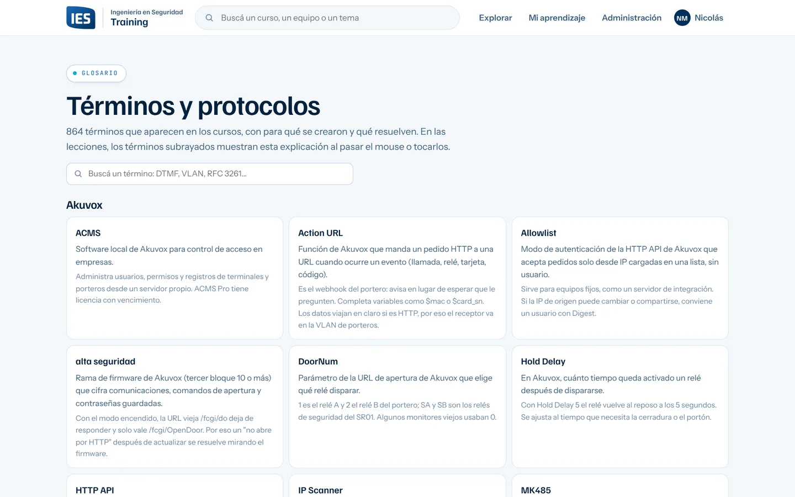<br><sub><b>Glosario.</b> 864 términos, 76 RFC con número, año y qué resolvieron.</sub></td>
    <td>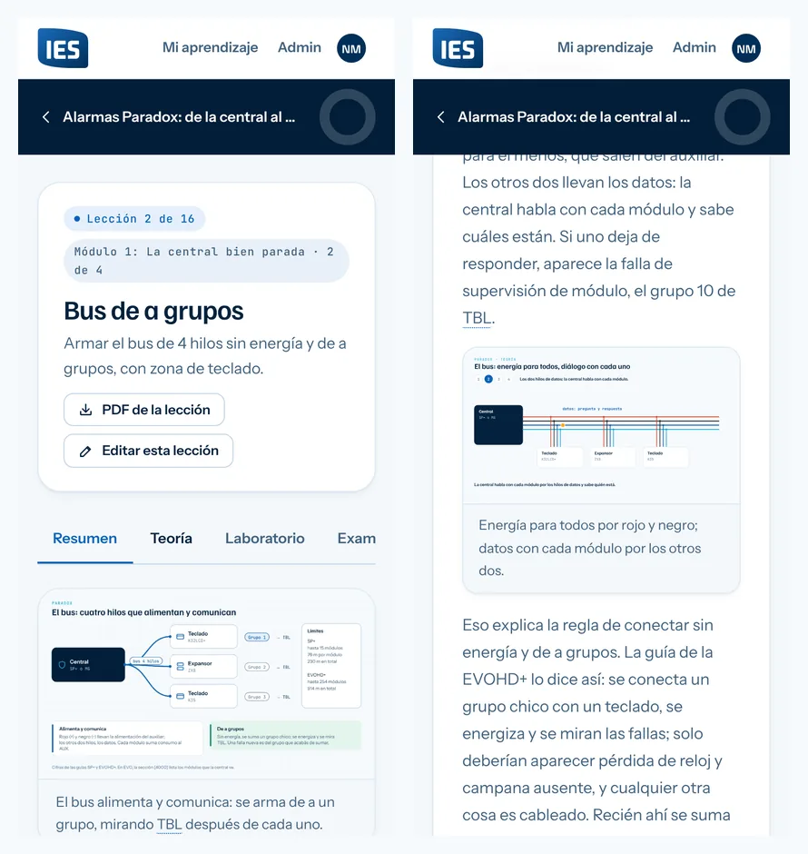<br><sub><b>En el celular.</b> El técnico lo usa en la obra.</sub></td>
  </tr>
</table>

---

## Los cursos

| | Curso | Lecciones | Módulos | Script | Qué se aprende |
|---|---|:-:|:-:|:-:|---|
| 🛜 | **MikroTik RouterOS para integradores** | 39 | 9 | `.rsc` | Entrar sin perder el acceso, VLAN, firewall input/forward y zonas, dos WAN (PPPoE, DHCP, IP fija), túneles WireGuard, L2TP e IPsec, DNS, Netwatch, Safe Mode |
| ☎️ | **Grandstream UCM** | 12 | 4 | | Central cerrada, extensiones, troncal, rutas, IVR, colas, NAT y portero SIP |
| 📶 | **UniFi** | 12 | 4 | | Adopción, VLAN y zonas, WiFi bien hecho, roaming, sitios y backups |
| 📡 | **Omada** | 12 | 4 | | Controlador, option 138, ACL, portal cautivo, mesh, VPN entre sedes |
| 🚪 | **Porteros IP Akuvox** | 42 | 9 | | SIP y DTMF, relés y cerraduras, apertura por HTTP, catálogo por modelo, licencias |
| 🎥 | **HikCentral Professional** | 12 | 4 | | Servidor, licencias, ISUP, grabación, alarmas, roles y control de acceso |
| 🚗 | **OmniAccess LPR** <sup>borrador</sup> | 12 | 4 | | Lectura de matrículas: cámara, calibración, monitor, merodeo, lista de vigilancia |
| 🙂 | **OmniAccess Face** <sup>borrador</sup> | 10 | 4 | | Reconocimiento facial, sincronización con terminales, enrolamiento y privacidad |
| 🚨 | **OmniAccess Intrusión** <sup>borrador</sup> | 10 | 4 | | Analítica de cámara, horario de armado, atender una alarma, falsas alarmas |
| 👥 | **OmniAccess Filas** <sup>borrador</sup> | 10 | 3 | | Conteo por ONVIF, aforo, tiempo de espera (ley de Little), alertas y reportes |
| 🔔 | **Alarmas Paradox** | 16 | 4 | | Bus, zonas con EOL, programación, BabyWare, Contact ID, MQTT, diagnóstico |
| 🔥 | **Bosch Incendio** | 16 | 4 | | Lazo LSN, aisladores, cálculos, programación con FSP-5000-RPS, red y mantenimiento |
| 🖥️ | **Proxmox VE** | 12 | 4 | `.sh` | KVM y LXC, almacenamiento, bridges VLAN, backups con PBS, clúster, HA |
| 🧊 | **VMware vSphere** | 12 | 4 | `.sh` | ESXi, vSwitch, datastores, snapshots, vMotion y HA, licencias |
| 🪟 | **Windows para técnicos** | 12 | 3 | `.ps1` | Red y SMB, firewall, RDP con NLA, servicios, UPS, eventos, BitLocker |
| 🐧 | **Linux para técnicos** | 12 | 4 | `.sh` | Archivos y permisos, systemd, procesos, red, SSH con llaves, firewall, mantenimiento |

Hay 68 horas de laboratorio en total. Los OmniAccess (software de [Infratec](https://infratec.com.uy)) se escribieron a partir del producto y están en borrador en el portal hasta su revisión.

---

## Anatomía de una lección

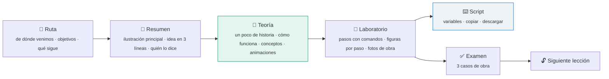

Las pestañas de cada lección son: **Resumen · Teoría · Laboratorio · Examen · La charla · Fuentes**. Las palabras técnicas y las RFC muestran un tooltip del glosario. Cada lección y cada curso se pueden bajar en **PDF**.

---

## Teoría animada

Cada lección tiene en su teoría al menos una animación del mecanismo que explica. Son SVG animados con CSS: sin JavaScript, con las fuentes de la marca embebidas, en loop, con leyenda numerada y un **cuadro fijo** para quien tiene "reducir movimiento" activado. Pesan alrededor de 50 KB cada una.

<table>
  <tr>
    <td width="50%"><br><sub><b>MikroTik · RIB y FIB.</b> Todas las rutas y las que se usan; qué pasa cuando cae un proveedor.</sub></td>
    <td width="50%"><br><sub><b>Akuvox · SIP directo.</b> INVITE, 180, 200 OK, ACK, audio RTP y el DTMF que abre el relé.</sub></td>
  </tr>
  <tr>
    <td><br><sub><b>Paradox · zona con EOL.</b> Lo que mide la central en cada estado del lazo.</sub></td>
    <td><br><sub><b>Bosch · aisladores.</b> El lazo sigue funcionando con un corto entre dos aisladores.</sub></td>
  </tr>
  <tr>
    <td><br><sub><b>Proxmox · quórum.</b> Votos, mayoría y por qué un nodo solo no decide.</sub></td>
    <td><br><sub><b>OmniAccess Filas · ley de Little.</b> Cómo se estima la espera a partir del aforo y las salidas.</sub></td>
  </tr>
</table>

---

## Ilustraciones de paso

Más de 770 ilustraciones dibujan lo que el técnico tiene que hacer o ver: qué cable va a qué borne, qué menú abrir o qué le pasa al paquete. No son decoración: cada figura sale de la tarjeta de la lección, con los mismos puertos, menús y valores de ejemplo.

<table>
  <tr>
    <td width="33%">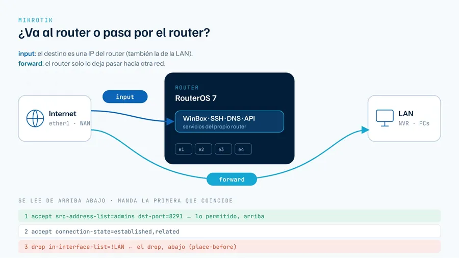<br><sub>MikroTik · ¿va al router o pasa por el router?</sub></td>
    <td width="33%">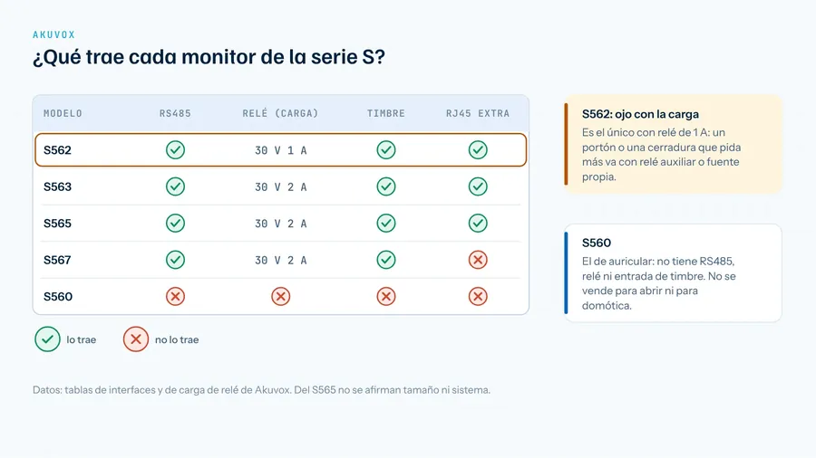<br><sub>Akuvox · relés y cerraduras</sub></td>
    <td width="33%">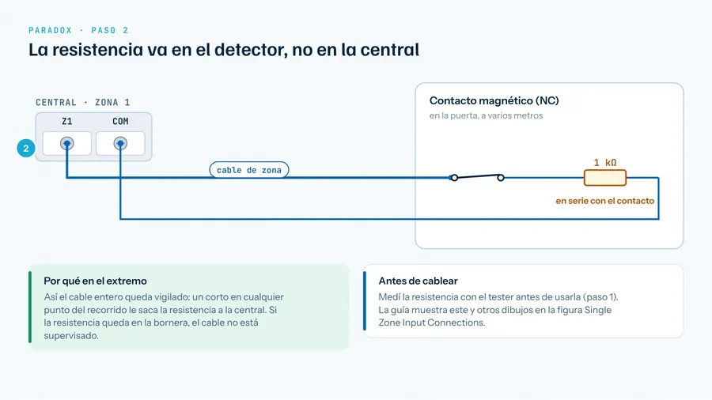<br><sub>Paradox · cableado de zona</sub></td>
  </tr>
  <tr>
    <td>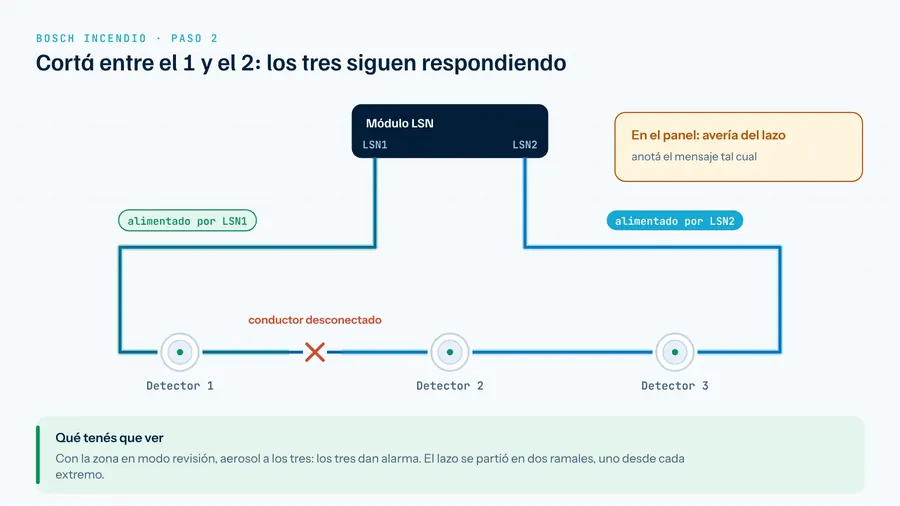<br><sub>Bosch · lazo y aisladores</sub></td>
    <td>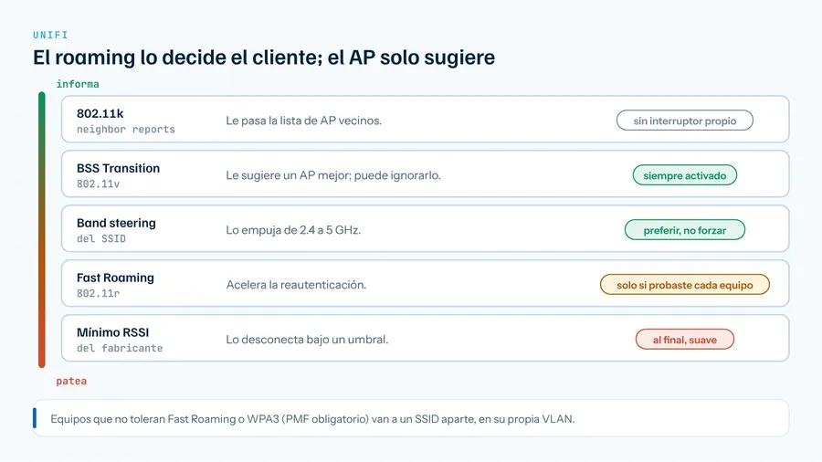<br><sub>UniFi · roaming</sub></td>
    <td>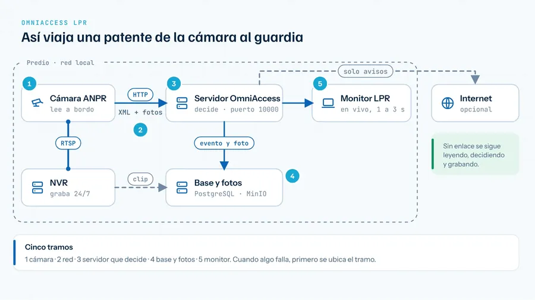<br><sub>OmniAccess LPR · recorrido de una lectura</sub></td>
  </tr>
</table>

---

## Editor y administración

<table>
  <tr><td>

**Para el alumno**
- Registro libre; sin cuenta solo se ven los títulos.
- Avance lineal por módulos, con progreso sincronizado.
- Examen por lección y marcado de laboratorio hecho.
- Glosario con tooltips y página propia.
- PDF por lección y por curso.

  </td><td>

**Para el staff (editar desde el frente)**
- Textos editables en el lugar, con barra de formato.
- Fotos pegadas con <kbd>Ctrl</kbd>+<kbd>V</kbd> en cada idea, concepto o paso.
- Ilustración principal que se pega, se arrastra o se sube y **se guarda sola**.
- Constructor de **GIF** con capturas pegadas.
- Módulos, objetivos, teoría y script editables.
- Historial: las últimas 60 versiones de cada curso.

  </td><td>

**Panel de administración**
- Indicadores y gráfico de 30 días.
- Fichas de usuarios con avance por curso.
- Salud del contenido de cada curso.
- Preguntas que más se fallan.
- Actividad y exportación a CSV.

  </td></tr>
</table>

---

## Arquitectura

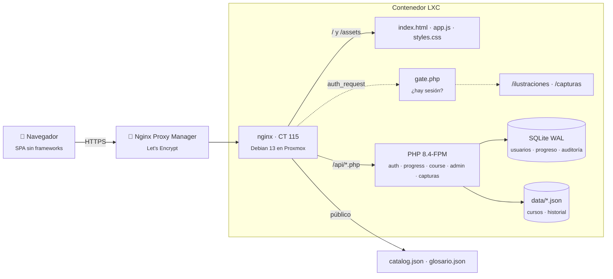

- **Contenido protegido:** `/data/<curso>.json` responde 403. El curso completo sale por `api/course.php`: con sesión devuelve todo y sin sesión solo el esquema. Las ilustraciones y las capturas pasan por `auth_request`.
- **Sesiones** con cookie `HttpOnly`, `Secure` y `SameSite=Lax`. Las escrituras exigen un encabezado propio, y hay bloqueo por intentos fallidos.
- **Sin build:** el front es un único `app.js`. El único vendor es [gifenc](https://github.com/mattdesl/gifenc) (MIT), para el constructor de GIF.

---

## Cómo se construye un curso

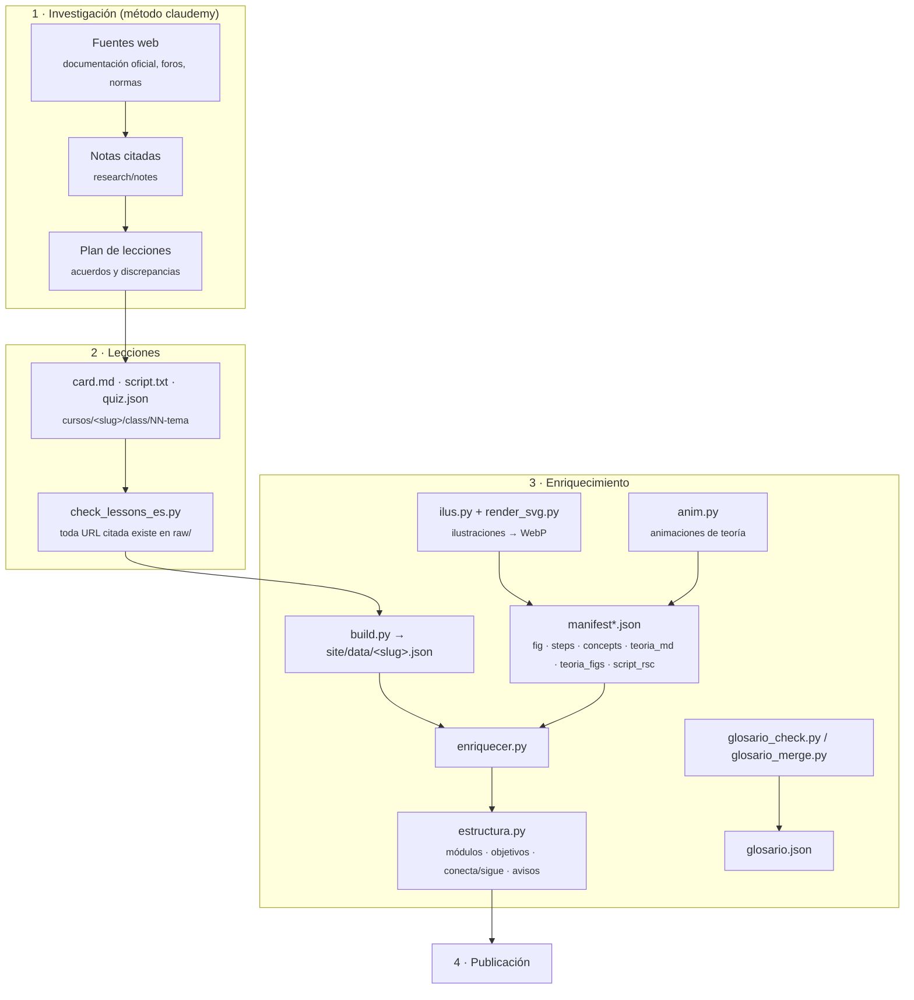

---

## Cómo se publica

El servidor es la fuente de verdad: lo que el staff edita en el panel nunca se pisa.

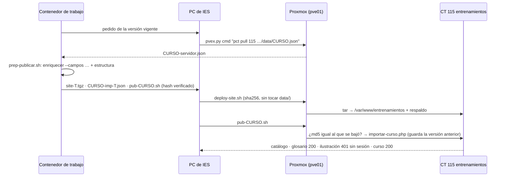

---

## Estructura del repositorio

```text
.
├── site/                    el portal tal como se publica
│   ├── index.html
│   ├── assets/              app.js · styles.css · vendor/gifenc
│   ├── api/                 auth · course · progress · admin · capturas · gate · lib (config.example.php)
│   ├── data/                catalog.json · glosario.json · <curso>.json (versión publicada)
│   └── ilustraciones/       <curso>/<id>.webp · <id>-paso<N>.webp · <id>-t<N>.svg (animadas)
├── cursos/<slug>/           método claudemy: sources.json · research/ · class/NN-tema/{card.md,script.txt,quiz.json}
├── ilustraciones/<slug>/    fuentes SVG, src/*.py, manifest*.json, estructura.json, glosario-propuesta.json
│   └── GUIA.md              especificación de ilustraciones, conceptos, teoría, animaciones y scripts
├── tools/                   construir, enriquecer, estructurar, animar, validar y publicar
├── deploy/                  creación del CT, nginx, NPM, despliegue e importación (sin credenciales)
├── skill/                   skill ies-entrenamientos para Claude
└── docs/                    briefs de contenido y tono · imágenes de este README
```

---

## Herramientas

| Herramienta | Qué hace |
|---|---|
| `tools/build.py <slug>` | Arma `site/data/<slug>.json` y el catálogo desde las tarjetas del curso |
| `tools/agregar-lecciones.py` | Suma o reemplaza lecciones sobre la versión del servidor sin pisar lo editado |
| `tools/enriquecer.py` | Aplica ilustraciones, pasos, conceptos, teoría, figuras de teoría y scripts (`--campos` para aplicar solo una parte) |
| `tools/estructura.py` | Módulos, orden lineal, objetivos, conecta/sigue, avisos y renumeración de la charla |
| `tools/ilus.py` · `tools/render_svg.py` | Biblioteca de ilustraciones SVG y render a WebP con las fuentes de la marca |
| `tools/anim.py` · `tools/anim_preview.py` | Animaciones SVG con CSS y vista previa por instante y cuadro fijo |
| `tools/glosario_check.py` · `tools/glosario_merge.py` | Valida el glosario y detecta RFC y siglas sin entrada; suma propuestas sin duplicar |
| `tools/check_lessons_es.py` | Verifica formato, tono y que toda URL citada exista en las fuentes guardadas |
| `tools/rsc_check.py` | Revisa los scripts RouterOS: variables, llaves, ASCII, comentarios `ies-` |
| `tools/prep-publicar.sh` | Prepara paquete, curso, glosario y script de publicación con verificación de md5 |
| `tools/importar-curso.php` | Importa un curso en el servidor y guarda la versión anterior en el historial |

---

## Probarlo en tu máquina

```bash
git clone https://github.com/flavioGonz/academy.git && cd academy
cp site/api/config.example.php site/api/config.php      # hash de la clave de editor (opcional)
mkdir -p entrenamientos-data                             # la base SQLite se crea sola al primer uso
php -S 127.0.0.1:8080 -t site
# abrí http://127.0.0.1:8080, registrate y hacete administrador:
sqlite3 entrenamientos-data/ies-training.sqlite "UPDATE users SET role='admin' WHERE email='vos@ejemplo.com';"
```

Hace falta PHP 8.x con `pdo_sqlite` y `mbstring`. Con el servidor de desarrollo de PHP no hay `auth_request`: las ilustraciones se sirven sin pedir sesión. En producción eso lo hace nginx (`deploy/nginx-acceso.sh`).

Para regenerar ilustraciones y animaciones hace falta Python 3 con Playwright (Chromium), Pillow y fontTools con brotli.

---

## Criterios de contenido

- **Exactitud:** todo sale de fuentes guardadas (documentación oficial primero) o del propio producto. Lo que no se pudo confirmar se dice en la lección.
- **Dibujar lo concreto:** qué cable, qué borne, qué menú, qué pasa con el paquete. Si un detalle no está confirmado, se dibuja genérico y rotulado.
- **Tono:** español rioplatense con voseo, cálido y directo, sin exigencias ni guiones largos.
- **Datos de ejemplo:** rangos de documentación (`192.0.2.x`, `198.51.100.x`, `203.0.113.x`), matrículas y personas inventadas. Sin datos de clientes.
- **Scripts:** se pueden pegar dos veces sin duplicar, no cortan el acceso de quien los pega y dejan comentados los pasos riesgosos. Conviene probarlos en un equipo de banco antes de usarlos en obra.

---

## Créditos

- **IES – Ingeniería en Seguridad**, Uruguay · [ies.com.uy](https://ies.com.uy) · contenido, revisión y uso en obra.
- **OmniAccess** es software de **Infratec** · [infratec.com.uy](https://infratec.com.uy).
- **Fuentes tipográficas:** Familjen Grotesk, Instrument Sans y JetBrains Mono (Google Fonts, SIL OFL).
- **Vendor:** [gifenc](https://github.com/mattdesl/gifenc) (MIT).
- Las marcas y los productos mencionados (MikroTik, Grandstream, Ubiquiti UniFi, TP-Link Omada, Akuvox, Hikvision, Paradox, Bosch, Proxmox, VMware, Microsoft Windows y otros) pertenecen a sus dueños. Este material es formación técnica independiente.
